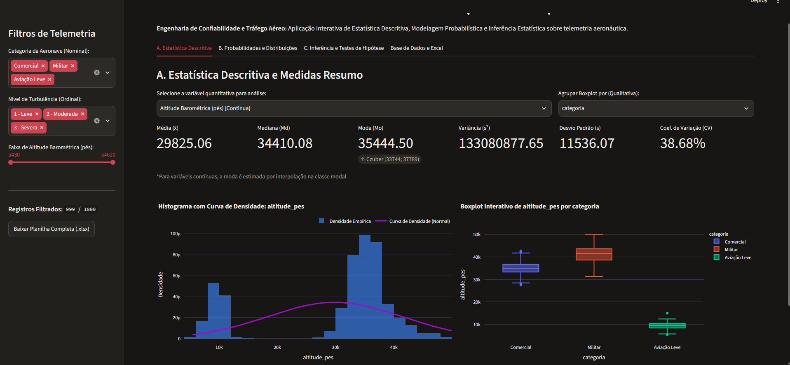
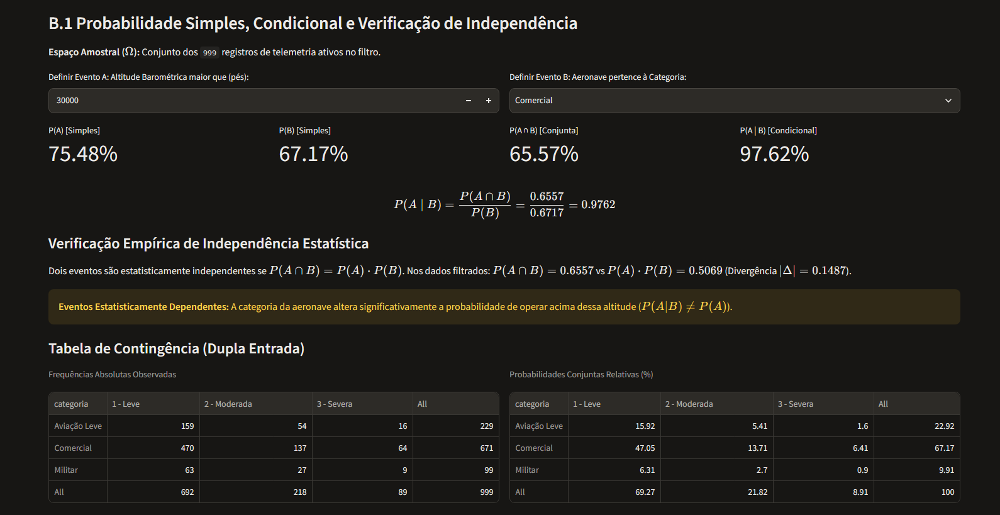
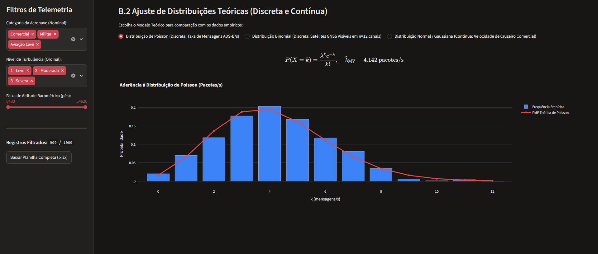
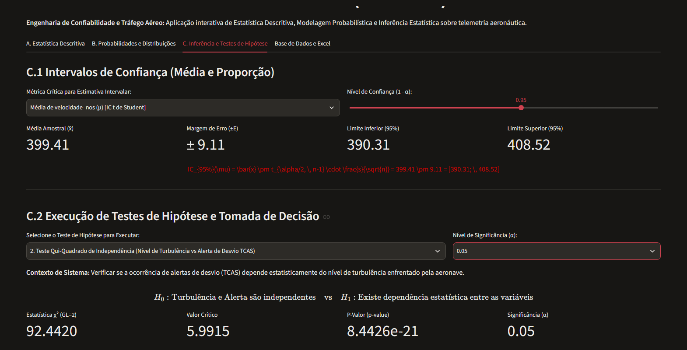
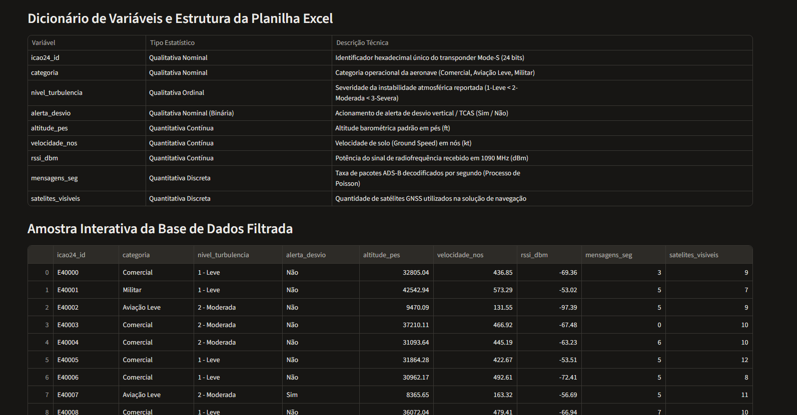

# Dashboard Analítico de Probabilidade e Estatística Aplicada (ADS-B)

Aplicação web interativa desenvolvida em Python e Streamlit para análise estatística descritiva, modelagem probabilística e inferência estatística. Atividade Final da Disciplina de Probabilidade e Estatística.

## Funcionalidades e Capturas de Ecrã

### A. Estatística Descritiva e Medidas Resumo
Cálculo dinâmico de Média, Mediana, Moda (exata e de Czuber), Variância, Desvio Padrão, Coeficiente de Variação (CV), Histograma com curva de densidade e Boxplots interativos filtráveis por categoria e altitude.


### B. Probabilidades e Distribuições Teóricas
Cálculo de probabilidade simples, condicional $P(A \mid B)$, verificação empírica de independência, tabela de contingência e comparação visual com modelos teóricos (Poisson, Binomial e Normal).



### C. Inferência Estatística e Testes de Hipótese
Estimativa de Intervalos de Confiança (95%) e execução interativa de Teste *t* de Welch (2 amostras), Qui-Quadrado ($\chi^2$), Teste *t* (1 amostra) e Teste *Z* de Proporções.


### Base de Dados e Exportação Excel
Dicionário das variáveis (contínuas, discretas, nominais e ordinais) e exportação direta para planilha `.xlsx` com 5 abas analíticas.



------------

## Como executar localmente

1. **Clonar o repositório e criar o ambiente virtual:**
```bash
git clone https://github.com/leonardo-ocr/dashboard_estatistica.git
cd dashboard_estatistica
python3 -m venv venv
source venv/bin/activate
```

2. **Instalar as dependências:**
```bash
pip install -r requirements.txt
```

3. **iniciar o dashboard:**
```bash
streamlit run app.py
```

